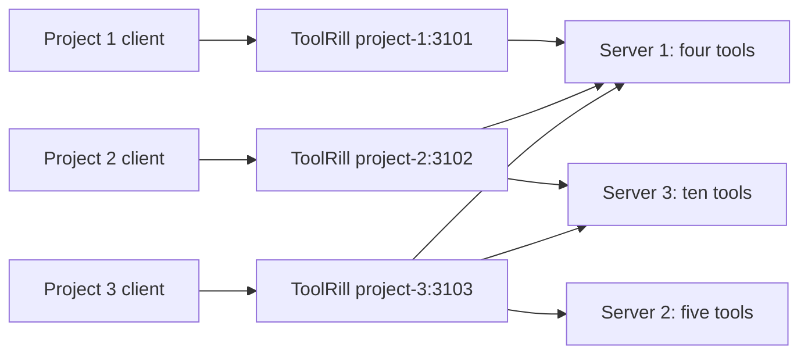

# ToolRill Customer Setup and Project Scenarios

This is a scenario guide using placeholder downstream servers, not a
self-contained runnable demo. For the included stdio and HTTP servers, start
with the [server sample walkthrough](../samples/README.md).

This guide explains how to use ToolRill with three downstream MCP servers and
different tool selections for three projects. The same configuration works
whether the clients are VS Code, Claude Code, or a custom MCP-capable workflow.

The recommended example uses one shared ToolRill configuration and three local
HTTP hosts. Installation determines how you launch ToolRill, not which tools a
project receives. The client connects to the endpoint assigned to its project.

## 1. Understand the Three Separate Concepts

| Concept | Meaning | Example |
| --- | --- | --- |
| ToolRill installation | Where the executable is obtained or resolved. | Global tool, local tool manifest, or repository clone. |
| ToolRill host configuration | Incoming endpoint and outgoing tool providers for a named host. | Host `project-2` in `toolrill.json`. |
| Client connection configuration | How VS Code, Claude Code, or another client connects to that host. | `http://127.0.0.1:3102/mcp`. |

One `toolrill.json` contains all ToolRill host settings. The separate
`instances.json` is no longer used. A consuming application's `appsettings.json`
is not automatically read or changed by ToolRill.

Clients still need their own MCP connection entries. ToolRill cannot replace
VS Code's or Claude Code's client settings: those entries specify how to reach
ToolRill, not which downstream servers it aggregates.



Each host applies its own filters and maintains its own downstream connections
and tool registry. Connections to the same downstream server are not pooled
across hosts. Server 1 must therefore support the separate connections from
these hosts; its own resource limits and session behavior still apply.

## 2. Assumptions and Expected Tools

Install the .NET 10 SDK for the steps in this guide. It supplies the tooling
needed for local tool manifests and source runs, and the .NET/ASP.NET Core
runtimes needed by this HTTP example. ToolRill itself does not require Python or
Node.js; downstream servers and clients have their own prerequisites.

The package installation commands assume a released `ToolRill` package containing
the unified-host configuration feature is available from your package source.
If it is not, use Setup 3 or obtain a matching `.nupkg` and add
`--add-source <package-directory>` to the install command. An older package
will not gain this feature just because its configuration file is renamed.

For this example, assume the downstream servers are already running:

| Server | MCP endpoint | Raw tool names used in this guide |
| --- | --- | --- |
| Server 1 | `http://127.0.0.1:5051/mcp` | `s1_tool1`, `s1_tool2`, `s1_tool3`, `s1_tool4` |
| Server 2 | `http://127.0.0.1:5052/mcp` | `s2_tool1` through `s2_tool5` |
| Server 3 | `http://127.0.0.1:5053/mcp` | `s3_tool1` through `s3_tool10` |

These names and addresses are examples, not servers or tools shipped with
ToolRill. Replace them with your servers' actual endpoints and tool names.
Tool filters use names, not numeric tool positions. Obtain the names from your
server's documentation or an MCP client's tool-discovery view. A URL responding
to an ordinary browser request is not proof that it implements MCP.

| Project | Required selection | Expected downstream tool count |
| --- | --- | --- |
| Project 1 | Server 1 tools 1-3; exclude tool 4; do not connect to Servers 2 or 3. | 3 |
| Project 2 | Server 1 tools 1-2 and Server 3 tools 1-8; do not connect to Server 2. | 10 |
| Project 3 | All four Server 1 tools, all five Server 2 tools, all ten Server 3 tools. | 19 |

These are ToolRill tool counts, not totals including the client's built-in tools
or other configured MCP providers. Client approvals, policies, schema support,
or disabled tools can further reduce what is usable. A model also need not call
every available tool.

## 3. Configuration Location and Complete Example

Use these example Windows locations; substitute your own paths:

```text
C:/McpSetup/toolrill.json          Shared ToolRill configuration
C:/Work/Project1/               First customer's project
C:/Work/Project2/               Second customer's project
C:/Work/Project3/               Third customer's project
C:/Tools/toolrill/                Repository clone, for Setup 3 only
```

Create the configuration directory before using `init`. ToolRill does not create
parent directories. The commands below use PowerShell:

```powershell
New-Item -ItemType Directory -Force C:/McpSetup
```

Initialize through your chosen installation method in Section 4, then replace
the generated default-host content with this full configuration in
`C:/McpSetup/toolrill.json`:

```json
{
  "diagnostics": {
    "enabled": false
  },
  "hosts": [
    {
      "name": "project-1",
      "incoming": {
        "transport": "streamable-http",
        "url": "http://127.0.0.1:3101"
      },
      "outgoing": [
        {
          "name": "server-1",
          "transport": "streamable-http",
          "url": "http://127.0.0.1:5051/mcp",
          "tools": {
            "include": ["s1_tool1", "s1_tool2", "s1_tool3"],
            "exclude": ["s1_tool4"]
          }
        }
      ]
    },
    {
      "name": "project-2",
      "incoming": {
        "transport": "streamable-http",
        "url": "http://127.0.0.1:3102"
      },
      "outgoing": [
        {
          "name": "server-1",
          "transport": "streamable-http",
          "url": "http://127.0.0.1:5051/mcp",
          "tools": {
            "include": ["s1_tool1", "s1_tool2"]
          }
        },
        {
          "name": "server-3",
          "transport": "streamable-http",
          "url": "http://127.0.0.1:5053/mcp",
          "tools": {
            "include": [
              "s3_tool1", "s3_tool2", "s3_tool3", "s3_tool4",
              "s3_tool5", "s3_tool6", "s3_tool7", "s3_tool8"
            ]
          }
        }
      ]
    },
    {
      "name": "project-3",
      "incoming": {
        "transport": "streamable-http",
        "url": "http://127.0.0.1:3103"
      },
      "outgoing": [
        {
          "name": "server-1",
          "transport": "streamable-http",
          "url": "http://127.0.0.1:5051/mcp"
        },
        {
          "name": "server-2",
          "transport": "streamable-http",
          "url": "http://127.0.0.1:5052/mcp"
        },
        {
          "name": "server-3",
          "transport": "streamable-http",
          "url": "http://127.0.0.1:5053/mcp"
        }
      ]
    }
  ]
}
```

### What the Keys Mean

- `hosts`: independent named ToolRill configurations; names are unique ignoring case.
- `name` on a host: selects a configuration with `--host`, not a client account.
- `incoming`: client -> ToolRill; its HTTP URL is the listening base address.
- `outgoing`: ToolRill -> downstream servers; each HTTP URL includes the server's MCP path.
- `name` on an outgoing server: your chosen identifier, unique within that host.
- `tools`: optional include/exclude filters for that outgoing server.
- `diagnostics`: shared ToolRill diagnostic settings, not separate host settings.

Clients connect to `incoming.url` plus `/mcp`. The incoming and outgoing URLs
must not be confused: port 3102 selects Project 2's gateway, while ports 5051
and 5053 reach the original downstream servers.

This example has no host named `default`, deliberately. Use an explicit
`--host project-1`, `--host project-2`, or `--host project-3` for individual-host
commands. Bare `toolrill` or `toolrill start` would look for `default` and fail;
`manager` does not require a default host. Alternatively, name one profile
`default` if you want it selected by short commands.

### Filter Behavior and Results

Filters match raw names such as `s1_tool1`, not qualified names such as
`server-1/s1_tool1`. Matching is case-insensitive. `*` is the supported wildcard;
for fixed selections prefer exact names.

A nonempty `include` permits only its matches. `exclude` always wins, even
when a name also appears in `include`. Project 1's explicit exclusion therefore
reinforces its three-tool allowlist; Project 2 does not need exclusions for
the names absent from its allowlists. Omitting `tools`, or using an empty
include list, allows all tools except any exclusions.

Project 1 and Project 2 use allowlists so newly added tools are not automatically
exposed. Project 3 intentionally has no filters, so new downstream tools will
be exposed after rediscovery on restart; its count would then exceed 19.

ToolRill exposes these qualified names:

| Host | Tools exposed by ToolRill |
| --- | --- |
| `project-1` | `server-1/s1_tool1`, `server-1/s1_tool2`, `server-1/s1_tool3` |
| `project-2` | `server-1/s1_tool1`, `server-1/s1_tool2`, plus `server-3/s3_tool1` through `server-3/s3_tool8` |
| `project-3` | All `server-1/...`, `server-2/...`, and `server-3/...` tools: 19 initially. |

Filtered tools cannot be listed or called through that host's gateway. Server
and host names are separate: host names are not added to qualified tool names.
Clients may display or translate MCP tool names differently for their models;
use the names returned by that client's SDK rather than guessing a translated
name. Compatibility with your actual tool schemas still needs manual review.

## 4. Choose an Installation Setup

Choose one setup, not all three. After initialization and editing the complete
example, start your downstream servers, run configuration validation, then
launch one manager. The client setup in Sections 5-7 is the same for all three
installation methods because clients connect over HTTP.

`init` creates an empty outgoing list, so it is normal for validation to fail
until you populate it. Repeating `init` against an existing file refuses to
overwrite it. Do not use `init` as an update or migration command.

### Setup 1: Globally Installed Tool

Install once for your user account:

```powershell
dotnet tool install --global ToolRill
Set-Location C:/McpSetup
toolrill init
```

After editing `C:/McpSetup/toolrill.json` with the full example:

```powershell
toolrill config validate --config C:/McpSetup/toolrill.json
toolrill manager --config C:/McpSetup/toolrill.json
```

Keep this manager terminal open. It launches three HTTP host processes.
The global tool directory must be on `PATH`; on Windows it is normally
`%USERPROFILE%/.dotnet/tools`. Restart shells or VS Code if their inherited
`PATH` predates installation. An absolute executable path is another option.

Global installation does not create a central settings file automatically.
The default configuration is `toolrill.json` in the command's working directory,
not beside the globally installed executable. The absolute `--config` path
above makes that choice explicit from any directory.

### Setup 2: Project-Local Tool

`dotnet tool install ToolRill` without `--global` means a manifest-scoped local
tool, not a global command or a NuGet library reference in your application's
project file. The tool is resolved through a `.config/dotnet-tools.json`
manifest, while its package files may be stored in the NuGet cache.

For one shared manager, install in Project 1 and launch it there:

```powershell
Set-Location C:/Work/Project1
dotnet new tool-manifest
dotnet tool install ToolRill
dotnet tool run toolrill -- init --config C:/McpSetup/toolrill.json
```

If the project already has a tool manifest, skip `dotnet new tool-manifest`.
Explicitly creating one when needed avoids relying on SDK-version-dependent
automatic manifest creation. Pin the desired released version with
`--version <version>` when installing if reproducibility matters.

After editing the shared configuration:

```powershell
Set-Location C:/Work/Project1
dotnet tool run toolrill -- config validate --config C:/McpSetup/toolrill.json
dotnet tool run toolrill -- manager --config C:/McpSetup/toolrill.json
```

Run these commands in the manifest's directory or its descendants. The
`--config` option selects ToolRill settings; it does not tell .NET where to find
the local tool manifest. A command launched from an unrelated folder may not
resolve the local tool, even if the configuration path is absolute.

Project 2 and Project 3 do not need ToolRill installed just to connect to these
HTTP hosts. Their MCP clients use the configured URLs. If each project must
also launch its own ToolRill process, create/install a local tool in each project
or use a deliberately shared parent manifest. After cloning a project that
already contains its manifest, run `dotnet tool restore` there instead of
reinstalling from scratch.

Keep the tool manifest separate from ToolRill's configuration:

```text
C:/Work/Project1/.config/dotnet-tools.json   Local tool/version declaration
C:/McpSetup/toolrill.json                     All three host configurations
```

Do not start one manager in each project against the same three HTTP profiles;
that would attempt to bind the same ports repeatedly. Use one shared manager,
or start distinct hosts individually as explained in Section 8.

### Setup 3: Repository Clone

Use the actual GitHub clone URL for this repository in place of the placeholder:

```powershell
git clone <repository-url> C:/Tools/toolrill
Set-Location C:/Tools/toolrill
dotnet run --project src/ToolRill/ToolRill.csproj -- init --config C:/McpSetup/toolrill.json
```

After editing the shared configuration:

```powershell
Set-Location C:/Tools/toolrill
dotnet run --project src/ToolRill/ToolRill.csproj -- config validate --config C:/McpSetup/toolrill.json
dotnet run --project src/ToolRill/ToolRill.csproj -- manager --config C:/McpSetup/toolrill.json
```

`dotnet run` builds as needed; you do not need a tool installation. The first
`--` separates .NET CLI options from ToolRill arguments. The explicit config path
keeps your customer setup independent of the repository's bundled samples.

The entry-point project is `src/ToolRill/ToolRill.csproj` and its assembly is
`ToolRill.dll`, matching the source-build example in the
[Docker customer guide](CUSTOMER_DOCKER_SETUP.md#setup-3-build-from-a-repository-clone).

Do not assume `--project src/ToolRill/ToolRill.csproj` selects the configuration beside the
source project. ToolRill resolves relative configuration paths from the working
directory. The bundled `development` and `work` profiles have empty outgoing
lists and are not the completed configuration shown in this guide.

### What You Should Expect After Manager Startup

| Host | Client MCP URL | Required downstream connections |
| --- | --- | --- |
| `project-1` | `http://127.0.0.1:3101/mcp` | Server 1 |
| `project-2` | `http://127.0.0.1:3102/mcp` | Servers 1 and 3 |
| `project-3` | `http://127.0.0.1:3103/mcp` | Servers 1, 2 and 3 |

Manager checks configured hosts and duplicate listening addresses before
launching. It does not probe whether ports are free or wait for a verified
ready state. An endpoint printed by manager is therefore not proof that its
child finished discovery or is healthy. Give startup time to complete and
check client connection status and child output if it fails.

Keep the foreground manager running while clients use these endpoints.
Ctrl+C requests manager shutdown and stops its child processes. This is not
a background service, and closing a client does not stop the shared manager.
There is no automatic child-process restart or load balancing.

## 5. Scenario 1: VS Code for All Three Projects

Requirements: Project 1 gets three Server 1 tools; Project 2 gets two Server 1
and eight Server 3 tools; Project 3 gets all 19 tools.

1. Complete Setup 1, 2, or 3 and run the manager using the shared configuration.
2. Open the three projects in separate VS Code windows.
3. Add only that project's ToolRill endpoint to its workspace MCP configuration.
4. Use `MCP: List Servers` to start/connect to the configured entry and inspect
   its output. Trust the workspace/server only after reviewing the configuration.
5. Use the chat tool picker to inspect and enable the tools needed for your task.
   Use an agent/chat mode that supports MCP tool calls.

For VS Code's workspace format, these files contain:

`C:/Work/Project1/.vscode/mcp.json`:

```json
{
  "servers": {
    "toolrill-project-1": {
      "type": "http",
      "url": "http://127.0.0.1:3101/mcp"
    }
  }
}
```

`C:/Work/Project2/.vscode/mcp.json`:

```json
{
  "servers": {
    "toolrill-project-2": {
      "type": "http",
      "url": "http://127.0.0.1:3102/mcp"
    }
  }
}
```

`C:/Work/Project3/.vscode/mcp.json`:

```json
{
  "servers": {
    "toolrill-project-3": {
      "type": "http",
      "url": "http://127.0.0.1:3103/mcp"
    }
  }
}
```

Recent VS Code versions also support a portable project-root `.mcp.json`
using a top-level `mcpServers` object, as shown for Claude Code below. Choose
one format for each VS Code project; do not duplicate the same server in both.
Consult your installed VS Code version's MCP configuration documentation.

Expected result: the three ToolRill entries expose 3, 10, and 19 downstream
tools respectively, all at the same time. The Project 1 entry does not expose
`server-1/s1_tool4`; Project 2 has no Server 2 tools or Server 3 tools 9-10.

Avoid putting all three endpoints into VS Code's user-wide MCP configuration
for this example. User-level providers or directly configured downstream
servers could expose extra tools in every project and defeat your intended
project-specific selection. Review existing providers and disabled-tool state.

## 6. Scenario 2: VS Code for Projects 1-2, Claude Code for Project 3

Requirements and `C:/McpSetup/toolrill.json` are unchanged. Only Project 3's
client changes; no new ToolRill installation or host schema is needed.

1. Start the manager through your chosen installation setup.
2. Configure VS Code Project 1 and Project 2 using the first two entries in
   Section 5. They connect to ports 3101 and 3102.
3. In Project 3's terminal, add the port 3103 endpoint to Claude Code at project
   scope, so it does not become an all-project user-level provider:

```powershell
Set-Location C:/Work/Project3
claude mcp add --transport http --scope project toolrill-project-3 http://127.0.0.1:3103/mcp
```

This creates or updates `C:/Work/Project3/.mcp.json` with an entry shaped like:

```json
{
  "mcpServers": {
    "toolrill-project-3": {
      "type": "http",
      "url": "http://127.0.0.1:3103/mcp"
    }
  }
}
```

4. Launch Claude Code from Project 3, review any project trust/MCP approval
   prompt, and use `/mcp` to inspect the connected provider and tools.
5. Confirm that this provider has all 19 tools. Review other Claude MCP
   providers and permission rules separately; they are not controlled by ToolRill.

Expected result: VS Code Project 1 has three tools, VS Code Project 2 has ten,
and Claude Code Project 3 has 19 from their respective ToolRill endpoints.
Changing the client product does not change the filtering policy.

The `claude` executable and a functioning Claude Code installation are separate
prerequisites. Claude Code's MCP `--scope project` is unrelated to .NET's local
tool manifest scope. Project-shared client configuration may be checked into
source control if suitable for your team, but review machine-specific URLs
and never include credentials in a committed file.

## 7. Scenario 3: VS Code Project 1, Claude Code Project 2, Custom Workflow Project 3

Again use the same three hosts in the same shared ToolRill file.

1. Start the manager through Setup 1, 2, or 3.
2. Configure VS Code Project 1 using its Section 5 entry at port 3101.
3. Configure Claude Code from Project 2's directory:

```powershell
Set-Location C:/Work/Project2
claude mcp add --transport http --scope project toolrill-project-2 http://127.0.0.1:3102/mcp
```

The resulting `C:/Work/Project2/.mcp.json` entry is:

```json
{
  "mcpServers": {
    "toolrill-project-2": {
      "type": "http",
      "url": "http://127.0.0.1:3102/mcp"
    }
  }
}
```

4. Review Claude Code project approvals and inspect `/mcp`; this connection
   should expose ten tools, not Project 3's unrestricted set.
5. Configure your Project 3 workflow's existing MCP client for Streamable HTTP
   at `http://127.0.0.1:3103/mcp`.
6. Have the workflow initialize an MCP session, discover tools with
   `tools/list`, and register the discovered definitions with its AI tool runner.
   Use its MCP SDK for any pagination, HTTP/SSE responses, and session handling.
7. Route a selected tool invocation through `tools/call` using the exact
   discovered name and schema-valid arguments, then return the tool result to
   the workflow. Dispose/close the client when finished.

If the workflow uses the common `mcpServers` connection format, its Project 3
configuration can look like this:

```json
{
  "mcpServers": {
    "toolrill-project-3": {
      "type": "http",
      "url": "http://127.0.0.1:3103/mcp"
    }
  }
}
```

This is a client-format example, not a universal workflow configuration file
or another ToolRill schema. Put it in the location your workflow documents;
other workflow products have different formats. If it has no MCP integration,
you must add an MCP SDK adapter there. ToolRill does not execute the AI workflow
or convert an ordinary REST/webhook client into an MCP client automatically.

Expected result: VS Code Project 1 gets three tools, Claude Code Project 2 gets
ten, and Project 3's custom workflow discovers all 19 through port 3103. This
does not mean a single HTTP GET lists tools or a POST of arbitrary JSON invokes
them: MCP initialization, protocol messages, and transport behavior still apply.

## 8. Alternatives: Individual Hosts, Stdio, or Per-Project Files

### Start Hosts Separately Instead of Using Manager

For a global installation, three separate terminals can run:

```powershell
toolrill start --host project-1 --config C:/McpSetup/toolrill.json
toolrill start --host project-2 --config C:/McpSetup/toolrill.json
toolrill start --host project-3 --config C:/McpSetup/toolrill.json
```

Run each command in its own terminal, not sequentially in one blocked terminal.
For local-tool or source setups, substitute the invocation form from Section 4.
Do not run these alongside manager for the same profiles and ports. Single-host
startup affects only the selected host; it never starts every configured host.

### Let Each Client Launch Its Own Stdio Host

For local per-client processes without HTTP listening ports, change each
host's incoming object in the shared ToolRill file to:

```json
"incoming": { "transport": "stdio" }
```

Keep each host's outgoing list and tool filters exactly as in Section 3.
Incoming stdio does not require outgoing stdio: the downstream HTTP servers
remain at ports 5051-5053. When incoming transport is stdio, ToolRill routes diagnostic output to stderr so stdout remains reserved for MCP protocol messages. Framework logging/status output on stderr is separate.

For a globally installed tool, VS Code Project 1's client entry becomes:

```json
{
  "servers": {
    "toolrill-project-1": {
      "type": "stdio",
      "command": "toolrill",
      "args": ["start", "--host", "project-1", "--config", "C:/McpSetup/toolrill.json"]
    }
  }
}
```

Use the matching host name in Projects 2 and 3. For Claude Code Project 2:

```powershell
Set-Location C:/Work/Project2
claude mcp add --transport stdio --scope project toolrill-project-2 -- toolrill start --host project-2 --config C:/McpSetup/toolrill.json
```

For a project-local tool, the equivalent VS Code launch fields are:

```json
"command": "dotnet",
"args": ["tool", "run", "toolrill", "--", "start", "--host", "project-1", "--config", "C:/McpSetup/toolrill.json"]
```

The launching client must use the project's manifest directory as its working
directory. Run Claude Code from that project, and ensure VS Code's selected
launch location resolves that manifest. A global tool or managed HTTP host is
simpler when you cannot control the client process's working directory.

For a repository clone, the launch fields can be:

```json
"command": "dotnet",
"args": ["run", "--project", "C:/Tools/toolrill/src/ToolRill/ToolRill.csproj", "--", "start", "--host", "project-1", "--config", "C:/McpSetup/toolrill.json"]
```

Source-based stdio startup builds as needed and can take longer than launching
an installed tool; concurrent first launches may contend on shared build
outputs. Prefer the installed tool or the managed HTTP example for routine
customer use. Adjust the client's startup timeout if needed rather than
assuming instant readiness.

For stdio, do not start manager: it skips stdio hosts. The client launches and
owns each ToolRill process. Multiple clients selecting one stdio profile still
create separate processes and downstream connections; they do not share a
stdio pipe. The filtering results remain 3, 10, and 19.

### Put One ToolRill File in Each Customer Project

The shared file is a recommendation for your multi-project setup, not a
requirement. Another valid layout is:

```text
C:/Work/Project1/toolrill.json   default host with Project 1's outgoing list
C:/Work/Project2/toolrill.json   default host with Project 2's outgoing list
C:/Work/Project3/toolrill.json   default host with Project 3's outgoing list
```

In each file, include only that project's host and rename it to `default`.
It still contains both incoming and outgoing setup, with no instances file.
Each client can then launch `start --config <that-project-file>` without
`--host`. Run separate processes for the files; manager accepts one file and
does not combine three external configuration files.

Per-project files are useful when independent repositories/teams own their
policies or need different root diagnostics settings. A shared file avoids
duplicating setup when one customer administers all profiles. Neither layout
automatically enforces user access or ties a profile to a project directory.

### Use Local .NET Downstream Servers

If a downstream server is a local .NET MCP project rather than an already
running HTTP endpoint, replace its outgoing entry's connection fields with:

```json
{
  "name": "server-1",
  "transport": "stdio",
  "command": "dotnet",
  "projectPath": "C:/McpServers/Server1/Server1.csproj",
  "tools": {
    "include": ["s1_tool1", "s1_tool2", "s1_tool3"],
    "exclude": ["s1_tool4"]
  }
}
```

Use the appropriate per-host filters, not the Project 1 filter everywhere.
When `projectPath` is set, ToolRill launches outgoing stdio as
`<command> run --project <path>`. Alternatively, use `command` with `args` for
standalone executables; see [stdio configuration](configuration.md#arbitrary-stdio-commands).
A separate downstream process is launched by each host that includes that server.

Use absolute `projectPath` values for shared configurations. Relative paths
resolve from the ToolRill process's working directory, not the directory of
`toolrill.json`; manager children inherit their parent's working directory.
Pointing to a shared config file does not establish the workspace root for
filesystem/database tools. Configure each downstream server's real data
scope and credentials using its own supported mechanisms.

## 9. Day-to-Day Configuration and Expectations

For the global invocation, these commands inspect the selected outgoing entries:

```powershell
toolrill server list --host project-1 --config C:/McpSetup/toolrill.json
toolrill server list --host project-2 --config C:/McpSetup/toolrill.json
toolrill config validate --host project-2 --config C:/McpSetup/toolrill.json
```

Use the local/source invocation prefix for Setups 2 and 3. `server list` prints
configured server names, enabled states, and transports, not discovered tool
names, counts, or live health. `config validate` checks settings, not whether
a downstream endpoint is reachable or a filter matches an actual tool.

`server add` and `server remove` edit only the selected host's outgoing list
in the base file. They do not edit client connection files, other hosts, or
environment overrides. There is no host-add command or tool-filter editing
option on `server add`; create additional host entries and edit `tools` in
the JSON manually. Do not re-add a server already present in that host.

After changing filters, server settings, or incoming addresses, restart the
affected ToolRill process. For the shared manager example, stop/relaunch manager
and reconnect or refresh the affected clients. Configuration and discovery
are not live-reloaded. Avoid simultaneous edits of the shared file; CLI writes
reformat JSON and do not preserve comments or original whitespace.

The selected base file may be overridden by an optional environment sibling,
such as `toolrill.Production.json`, then `TOOLRILL_` environment variables.
`DOTNET_ENVIRONMENT` defaults to `Production`. No override file is required.
For predictable first setup, use only the shared base file and review any
existing override files/variables before diagnosing unexpected selections.

For example, `TOOLRILL_hosts__1__outgoing__0__enabled=false` disables Project 2's
first outgoing server with the array order shown in this guide. Array overrides
are index-based, not matched by host/server name. An override can change a
base-file entry after editing; inspect the effective environment too.

## 10. Security, Availability, and Common Mistakes

Tool filters control exposure through the chosen host; they are not an
authentication or authorization system. A client that can connect to port 3103
can reach Project 3's unfiltered tools regardless of its project name.
ToolRill does not prove that a client belongs to Project 1 or prevent it from
selecting another accessible profile. Local-tool installation is not a sandbox
or project permission boundary either.

Keep these examples bound to loopback on a trusted machine. Do not replace
loopback with `0.0.0.0` or expose hosts to a shared network assuming per-project
filters protect them. Strong isolation needs separately controlled endpoints,
downstream credentials/data permissions, and an appropriate security design.
Authenticated outgoing headers/OAuth and inbound access control are not
configured by the minimal schema shown here; do not invent unsupported keys.

| Symptom | Likely cause or action |
| --- | --- |
| `toolrill` is not found | Global tool is absent or its directory is not on the client's `PATH`; use the correct local/source invocation if not globally installed. |
| Local tool cannot be resolved | Launch directory cannot find the tool manifest; restore tools and run in the intended project. |
| Configuration file not found | Relative path points to another working directory; pass an absolute `--config`. |
| Host `default` not found | This guide uses `project-1`/`project-2`/`project-3`; supply `--host` or use manager. |
| No HTTP hosts configured | Incoming hosts are stdio; let clients launch them, or configure HTTP hosts. |
| Port/address conflict | Another process or another manager uses a listening port; use distinct free ports and change the matching client URL. |
| Manager prints a URL but client cannot connect | Child may still be starting or may have failed; inspect output and downstream availability. |
| Tool count is lower than expected | Actual raw names differ, schemas/client policies reject tools, filters exclude them, or a downstream connection failed. |
| Extra tools appear | Wrong endpoint/profile, other MCP providers, changed downstream tool inventory, empty include list, or an environment override. |
| Edits have no effect | Process/client retained old discovery; restart/reconnect and inspect environment overrides. |
| Stdio protocol errors | Diagnostic stdout or other unexpected stdout may corrupt the protocol; keep ToolRill diagnostics disabled and inspect client logs. |
| Remote/WSL/container client cannot reach localhost | Loopback refers to that client's execution environment, not automatically your Windows host; adapt deployment/networking deliberately. |

A failed downstream connection stops that host's startup rather than providing
a partially connected tool set. Different hosts are separate processes, but
manager does not supervise/restart failed children. Tool call failures propagate
to the client. Existing concurrency and availability behavior has not been
load-tested by this guide; three profiles are configurations, not a capacity
or performance guarantee.

## 11. Your Manual Review Checklist

1. Confirm your installed tool/source version supports the unified schema.
2. Confirm your actual Server 1/2/3 tool names and MCP endpoints.
3. Confirm the correct installation invocation resolves before setting up clients.
4. Populate all outgoing lists, validate settings, and start the required hosts.
5. Connect Project 1 to port 3101 and check only its three downstream tools.
6. Connect Project 2 to port 3102 and check the two-plus-eight selection.
7. Connect Project 3 to port 3103 and check all 19 downstream tools.
8. Confirm blocked names do not appear in that host's discovered list; review
   additional client providers so they do not bypass this intended setup.
9. Invoke one permitted, non-destructive tool through each client's normal
   approval flow and confirm that the result comes from the expected server.
10. Restart after configuration changes and confirm clients refresh discovery.

## References

- [ToolRill CLI guide](cli.md)
- [ToolRill host/server configuration](configuration.md)
- [ToolRill diagnostics](diagnostics.md)
- [VS Code MCP configuration](https://code.visualstudio.com/docs/copilot/customization/mcp-servers)
- [Claude Code MCP setup and scopes](https://code.claude.com/docs/en/mcp)