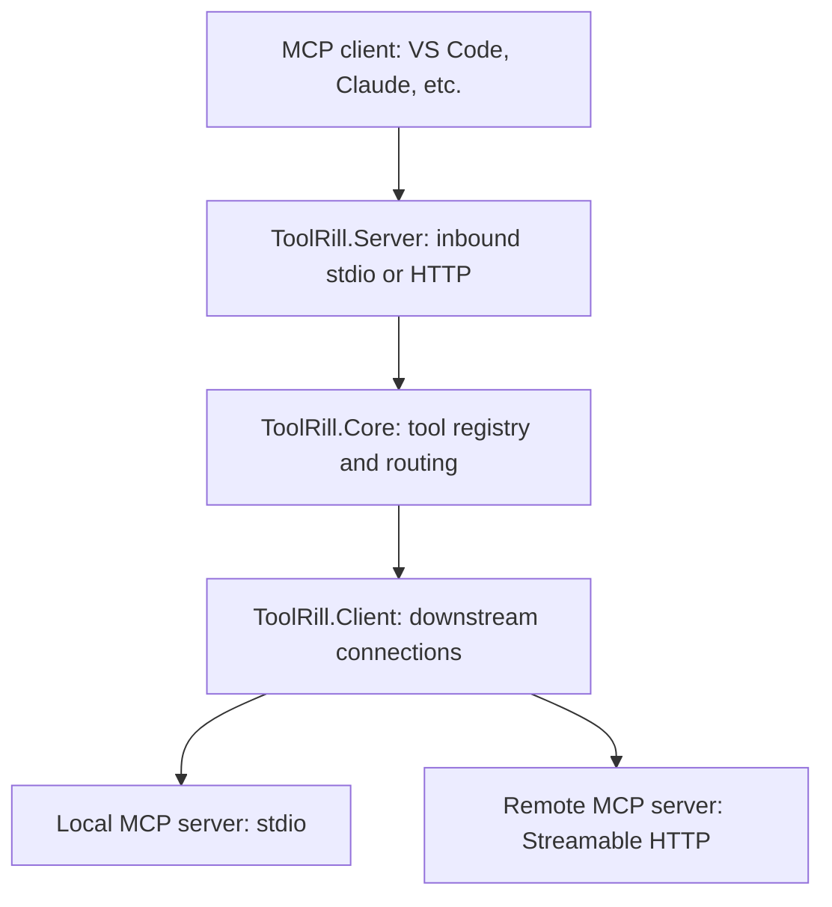

# Architecture

ToolRill is a .NET MCP host and tool gateway. An MCP client connects to one
ToolRill endpoint, which exposes tools from one or more downstream MCP servers.
The host uses the C# MCP SDK for protocol handling rather than implementing
JSON-RPC itself.

## Project Roles

| Project | Responsibility |
| --- | --- |
| `ToolRill` | Application entry point, commands, configuration loading, and host startup/shutdown. |
| `ToolRill.Core` | Configuration validation, server connections and states, tool aggregation, filtering, and routing. |
| `ToolRill.Client` | SDK-based transports for connecting to downstream stdio and HTTP servers. |
| `ToolRill.Server` | SDK-based inbound MCP server that exposes aggregated tools over stdio or HTTP. |

ToolRill itself requires no Python or Node.js runtime. Downstream servers have their own runtime requirements; the stdio transport can launch .NET projects or standalone executables.

## Startup

The application starts in [Program.cs](../src/ToolRill/Program.cs). Host startup:

1. Loads `toolrill.json`, selects the named host (`default` or `--host`), and
	validates its incoming settings and outgoing server entries.
2. Connects to enabled downstream servers through `McpServerManager`.
3. Discovers tools and applies each server's filters in `McpToolRegistry`.
4. Creates `McpToolRouter` and the `McpHostTools` interface.
5. Exposes the resulting tools through its incoming transport and URL, subject
	to temporary `--mode` and `--url` overrides.

Disabled servers are skipped. Tools are discovered at startup; configuration
and tool changes require a host restart.

## Tool Requests

Tools are exposed as `server/tool`, for example `local/hello`. The server prefix
distinguishes tools with the same name on different downstream servers.

The inbound server adapter receives the call and passes it through
`McpHostTools` to `McpToolRouter`. The router checks the registry, selects the
owning connection, and calls the downstream tool using its raw name (`hello`).
The adapter returns the result as serialized JSON text and preserves the
downstream tool's input schema when exposing it.

Both inbound adapters accept the SDK request cancellation token and forward
it through `McpHostTools`, `McpToolRouter` and `McpServerConnection` to the
downstream SDK call. `ToolRill.Client` supplies a linked cancellation budget:
`toolCallTimeoutSeconds` defaults to 60 seconds per call. Core APIs distinguish
budget expiration (`TimeoutException`) from caller cancellation
(`OperationCanceledException`); the inbound SDK handles their MCP representation.

The current gateway aggregates tools; it is not a general-purpose proxy for
every MCP capability.

## Connections and Lifecycle

Stdio connections launch a local server process. HTTP connections use an
already-running downstream service. The inbound transport is independent of
these choices: either host mode can aggregate both kinds of downstream server.

A failed downstream connection stops startup and triggers cleanup. Tool-call
errors propagate to the caller. The core includes explicit reconnect operations,
but the CLI does not expose live reconnect or automatic retry. On shutdown,
the host disconnects and disposes its downstream connections.

Each outgoing entry has a `connectionTimeoutSeconds` budget (default 30 seconds)
for connection initialization and a fresh budget for each discovery call,
including startup discovery. Startup/reconnect caller cancellation is linked
to the connection budget. The HTTP transport has no separate `HttpClient`
timeout competing with these budgets. See [Configuration](configuration.md#timeouts-and-cancellation)
for ranges and overrides. Cancellation signals the downstream cooperatively;
it does not guarantee stopped work, rollback, forced process termination or
a bounded shutdown. A tool-call timeout leaves the connection available for
subsequent requests; no automatic retry is added.

## Host Modes

- **Stdio:** the initial default; an MCP client launches its own foreground
	host process, selecting a configuration with `--host` when needed.
- **HTTP:** a foreground host exposes `/mcp` for clients connecting over HTTP.
- **Manager:** reads all HTTP hosts from the same `toolrill.json` and launches
	independent processes. Each selects its own incoming URL and outgoing list;
	it is not one shared registry across hosts. Stdio hosts are skipped.

Multiple clients can use distinct named hosts at the same time, selecting
different outgoing tool sets. There is no separate instances file, external
per-host configuration reference, or automatic per-client request routing.

## Related Guides

- [Server configuration, transports, and tool filters](configuration.md)
- [CLI commands and installation](cli.md)
- [Containerization](containerization.md)
- [Diagnostics](diagnostics.md)
- [Benchmarks](benchmarks.md)